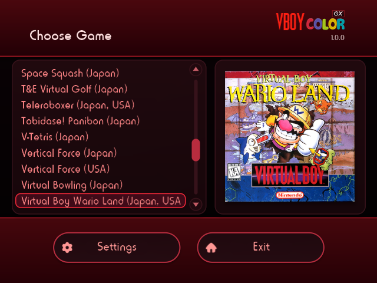
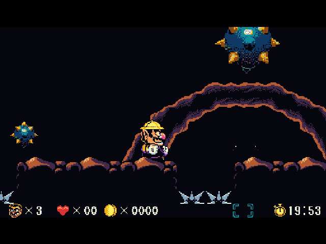

# 

VBoy Color GX is a Wii and Wii U port of [VBoy Color](https://github.com/yuk27/VBoyColor), a Virtual Boy emulator that adds color. It uses a modified version of Tantric's [FCE Ultra GX](https://github.com/dborth/fceugx) frontend for a clean, familiar way to browse and load games.

***You can download the forwarder for this emulator [here!](https://github.com/cmyksoda/vboy-color-gx-forwarder-channel)***





## Features

- **Full speed:** 21 of the 26 games (24 released, 2 unreleased prototypes) run at full speed, and 4 more at full speed or close to it, on a Wii and on a Wii U in Wii mode.[^1]
  - At full speed: 3-D Tetris, Bound High!, Dragon Hopper, Golf, Innsmouth no Yakata, Jack Bros., Mario Clash, Mario's Tennis, Niko-chan Battle, SD Gundam - Dimension War, Space Invaders Virtual Collection, Space Squash, Teleroboxer, V-Tetris, Virtual Bowling, Virtual Boy Wario Land, Virtual Fishing, Virtual Lab, Virtual League Baseball, Waterworld, and Zero Racers.
  - Close to full speed: Galactic Pinball, Nester's Funky Bowling, Panic Bomber, and Red Alarm.
- **A Wii U version:** `vbcgx-wiiu.wuhb` runs on the Wii U itself under [Aroma](https://aroma.foryour.cafe/), with the GamePad and touch on its screen. The speeds above are for the Wii version. The Wii U version has been timed too, and its numbers are on the [Speed Benchmark](https://cmyksoda.cc/vbcgx/bench)'s Wii U tab.
- **Lots of color options:** each game's own color pack, automatic colors, multicolor palettes, gradients, and tints (presets or your own).
- **240p** for crisp pixels on CRT televisions, plus 480p and 480i.
- **Save states, screenshots, and cover art** through the GX frontend.
- **WiiFlow Lite plugin** for starting games straight from WiiFlow.
- **Controllers:** Wii Remote + Nunchuk, Classic Controller, Wii U Pro Controller, GameCube controller, and the Wii U GamePad.
- **Button mapping** for buttons and stick directions. By default the left stick is mapped to the Virtual Boy's left d-pad and the right stick to its right d-pad.

## Installing

On a Wii, or a Wii U in Wii mode: copy the `apps/vbcgx/` and `vbcgx/` folders from `vbcgx.zip` to the root of your SD card or USB device, then put your games in `vbcgx/roms/`.

On a Wii U with Aroma: copy `vbcgx-wiiu.wuhb` to `sd:/wiiu/apps/`, put your games in `vbcgx/roms/` on the SD card, and start the app from the Wii U Menu.

For WiiFlow Lite, also copy the `wiiflow/` folder to the root of your SD card and turn on the "Virtual Boy" plugin in WiiFlow's settings. The plugin finds your games in `sd:/vbcgx/roms/`.

## Building

VBoy Color GX builds with devkitPPC and [libogc2](https://github.com/extremscorner/libogc2) (not devkitPro's libogc), plus Tantric's fork of [libsmb2](https://github.com/dborth/libsmb2). The easiest way is the libogc2 container, which `tools/build-wii.sh` runs with [Podman](https://podman.io/):

```
git clone https://github.com/cmyksoda/vbcgx.git
cd vbcgx
tools/build-wii.sh
```

The first build also downloads and builds libsmb2. The result is `executables/vbcgx-wii.dol`. To lay it out with the SD card folders, run `python3 tools/package.py`; the zip lands in `dist/`.

The Wii U version builds the same way with `tools/build-wiiu.sh`, which makes `executables/vbcgx-wiiu.wuhb`.

## Credits

- **VBoy Color** by yuk27 and contributors, which grew out of CidVonHighwind's [VirtualBoyGo](https://github.com/CidVonHighwind/VirtualBoyGo)
- **Beetle VB**, Mednafen's Virtual Boy core, by Ryphecha and contributors
- **FCE Ultra GX** by Tantric (Daryl Borth), the frontend this one is built on, with menu artwork by the3seashells and menu sounds by Peter de Man
- **WiiMednafen** by raz0red, for its idle-loop handling; WiiMednafen and WiirtualBoy also guided the controller design
- **libogc2** by Extrems, and **devkitPPC** by devkitPro
- **libwiidrc** by FIX94, for Wii U GamePad support
- The VBoy Color logo artwork by Juan, from the VBoy Color project
- The Virtual Boy controller icon, from a photo by Sesu Prime with a cutout by JohnnyMrNinja ([CC BY-SA 3.0](https://creativecommons.org/licenses/by-sa/3.0/))
- The menu music, ["Bells Melody Retro SynthWave 35B"](https://www.looperman.com/loops/detail/247262/bells-melody-retro-synthwave-35b-abelouis-free-96bpm-ambient-pad-loop), by abelouis on Looperman

The full list, with every library, is in [NOTICE](NOTICE).

## License

VBoy Color GX is free software under the [GNU General Public License, version 3](LICENSE). Some parts use other licenses: Beetle VB is GPL version 2 or later, the libraries have their own licenses, and the controller icon is CC BY-SA 3.0. All the texts are in [`licenses/`](licenses/), and [NOTICE](NOTICE) says which applies where.

VBoy Color GX doesn't include any games. Virtual Boy is a trademark of Nintendo, and this project isn't affiliated with Nintendo.

---

*This project was made with AI assistance. For more information, see [my AI usage statement](https://github.com/cmyksoda/cmyksoda/blob/main/AI_USAGE.md).*

[^1]: Speeds come from the [Speed Benchmark](https://cmyksoda.cc/vbcgx/bench), which times every scene of the 26 games with the Wii build of version 2.0.0, on a Wii and on a Wii U in Wii mode. A game runs is listed as full speed when the slowest 50-frame stretch of every scene takes 18.0 ms a frame or less on both consoles. The Virtual Boy needs 19.9 or less, and the games close to full speed have some scenes between 18.1 and 19.9 ms. One scene is slightly over 19.9 ms: the second base of stage 2 in Vertical Force takes 20.1 ms on a Wii U in Wii mode. On a Wii it takes 19.5 ms. Reports of other slow spots are welcome.
