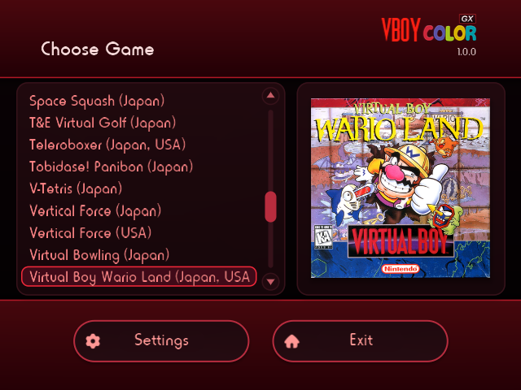
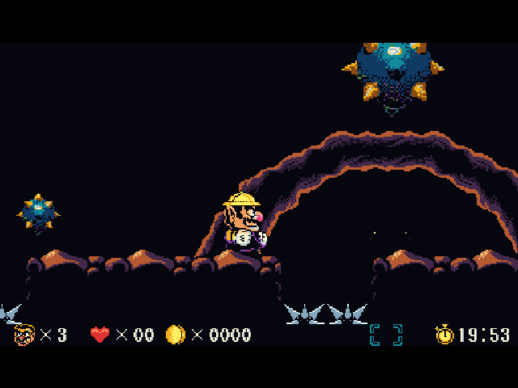

# 

VBoy Color GX is a Wii port of [VBoy Color](https://github.com/yuk27/VBoyColor), a Virtual Boy emulator that adds color. It uses a modified version of Tantric's [FCE Ultra GX](https://github.com/dborth/fceugx) frontend for a clean, familiar way to browse and load games.





## Features

- **Full-speed gameplay** in every official Virtual Boy release.[^1]
- **Lots of color options:** each game's own color pack, automatic colors, multicolor palettes, gradients, and tints (presets or your own).
- **240p** for crisp pixels on CRT televisions, plus 480p and 480i.
- **Save states, screenshots, and cover art** through the GX frontend.
- **Controllers:** Wii Remote + Nunchuk, Classic Controller, Wii U Pro Controller, GameCube controller, and the Wii U GamePad (in vWii).

## Building

VBoy Color GX builds with devkitPPC and [libogc2](https://github.com/extremscorner/libogc2) (not devkitPro's libogc), plus Tantric's fork of [libsmb2](https://github.com/dborth/libsmb2). The easiest way is the libogc2 container, which `tools/build-wii.sh` runs with [Podman](https://podman.io/):

```
git clone https://github.com/cmyksoda/vbcgx.git
cd vbcgx
tools/build-wii.sh
```

The first build also downloads and builds libsmb2. The result is `executables/vbcgx-wii.dol`. To lay it out with the SD card folders, run `python3 tools/package.py`; the zip lands in `dist/`.

## Installing

Copy the `apps/vbcgx/` and `vbcgx/` folders to the root of your SD card or USB device, then put your games in `vbcgx/roms/`.

## Credits

- **VBoy Color** by yuk27 and contributors, which grew out of CidVonHighwind's [VirtualBoyGo](https://github.com/CidVonHighwind/VirtualBoyGo)
- **Beetle VB**, Mednafen's Virtual Boy core, by Ryphecha and contributors
- **FCE Ultra GX** by Tantric (Daryl Borth), the frontend this one is built on, with menu artwork by the3seashells and menu sounds by Peter de Man
- **WiiMednafen** by raz0red, for its idle-loop handling; WiiMednafen and WiirtualBoy also guided the controller design
- **libogc2** by Extrems, and **devkitPPC** by devkitPro
- **libwiidrc** by FIX94, for Wii U GamePad support
- The VBoy Color logo artwork by Juan, from the VBoy Color project
- The Virtual Boy controller icon, from a photo by Sesu Prime with a cutout by JohnnyMrNinja ([CC BY-SA 3.0](https://creativecommons.org/licenses/by-sa/3.0/))
- The menu music, ["Bells Melody Retro SynthWave 35B"](https://www.looperman.com/loops/detail/247262/bells-melody-retro-synthwave-35b-abelouis-free-96bpm-ambient-pad-loop), by abelouis on Looperman

The full list, with every library, is in [NOTICE](NOTICE).

## License

VBoy Color GX is free software under the [GNU General Public License, version 3](LICENSE). Some parts use other licenses: Beetle VB is GPL version 2 or later, the libraries have their own licenses, and the controller icon is CC BY-SA 3.0. All the texts are in [`licenses/`](licenses/), and [NOTICE](NOTICE) says which applies where.

VBoy Color GX doesn't include any games. Virtual Boy is a trademark of Nintendo, and this project isn't affiliated with Nintendo.

---

*This project was made with AI assistance. For more information, see [my AI usage statement](https://github.com/cmyksoda/cmyksoda/blob/main/AI_USAGE.md).*

[^1]: Measured on a Wii and on a Wii U in Wii mode. Two scenes outside gameplay still slow down: Mario Clash's opening movie, only slightly (at its slowest about 50 frames per second on a Wii and 48 on a Wii U, against the Virtual Boy's 50.27), and the house picture at the start of Innsmouth no Yakata.
